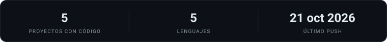

 

### Tecnologías

 

### Proyectos destacados

<table>
<tr>
<td width="50%"></td>
<td width="50%"></td>
</tr>
<tr>
<td width="50%"></td>
<td width="50%"></td>
</tr>
</table>

 

### Estadísticas

 

### Contribuciones

<picture>
  <source media="(prefers-color-scheme: dark)" srcset="https://raw.githubusercontent.com/IrvinChavez/IrvinChavez/output/github-snake-dark.svg" />
  <source media="(prefers-color-scheme: light)" srcset="https://raw.githubusercontent.com/IrvinChavez/IrvinChavez/output/github-snake.svg" />
  
</picture>

