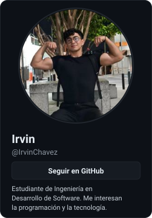
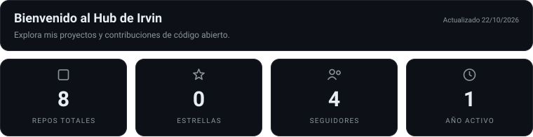
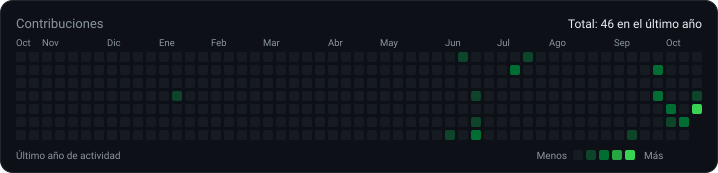
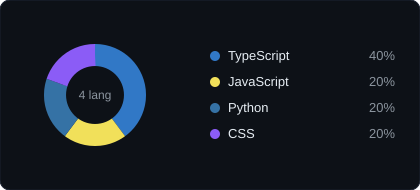
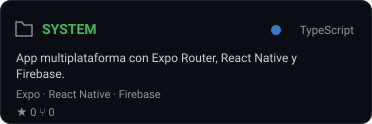
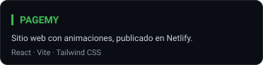
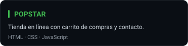
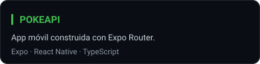
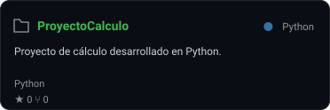
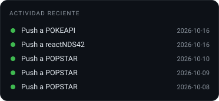

<table>
<tr>
<td width="27%" valign="top" align="center">

🔗 [pagemy.netlify.app](https://pagemy.netlify.app/)

</td>
<td width="73%" valign="top">

</td>
</tr>
</table>

<table>
<tr>
<td width="50%" valign="top">

**TECNOLOGÍAS**

</td>
<td width="50%" valign="top">

</td>
</tr>
</table>

**PROYECTOS DESTACADOS**

<table>
<tr>
<td width="50%"></td>
<td width="50%"></td>
</tr>
<tr>
<td width="50%"></td>
<td width="50%"></td>
</tr>
<tr>
<td width="50%"></td>
<td width="50%" valign="top">

</td>
</tr>
</table>

Panel generado con datos reales de GitHub · se actualiza cada día · <a href="https://irvinchavez.github.io/">ver Hub completo</a>

